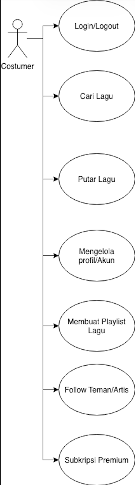
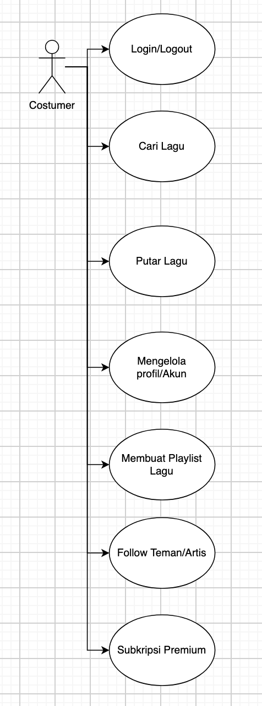
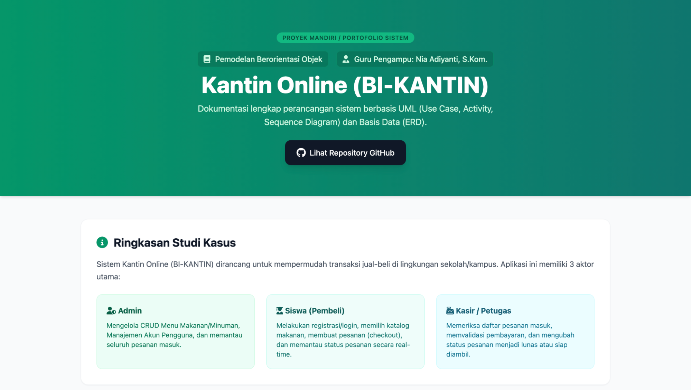

# TUGAS MANDIRI / PROJEK MANDIRI SISWA
## KANTIN ONLINE (BI-KANTIN)

> Sumber: Google Docs LK PBO, tab **"SOAL BI KANTIN"**.

### Timeline PBO – APK BI-KANTIN

| Tanggal | Target |
|---|---|
| 28 Oktober 2026 | Use Case & Activity Diagram |
| 4 November 2026 | Activity Diagram & Sequence Diagram |
| 11 November 2026 | Sequence Diagram & ERD |

---

## A. STUDI KASUS: SISTEM KANTIN ONLINE (BI-KANTIN)

Aplikasi web ini memiliki 3 peran utama (Aktor) dengan sistem autentikasi (Login/Role) sebagai berikut:

### 1. Sisi Admin (Pengelola Kantin / Petugas)

- **CRUD Menu Makanan/Minuman:** Admin dapat menambah menu baru (nama, harga, kategori, foto/deskripsi), mengedit data menu, atau menghapus menu.
- **CRUD Akun Pengguna:**
  1. **Create (Tambah Akun)** – Admin dapat mendaftarkan pengguna baru ke dalam sistem. Atribut yang biasanya diisi meliputi:
     - Nama Lengkap / Username: Identitas pengguna.
     - Email / No. Telepon: Digunakan untuk identifikasi unik atau login.
     - Password: Kata sandi (biasanya di-hash menggunakan algoritma keamanan seperti Bcrypt).
     - Role / Hak Akses: Menentukan tingkat wewenang pengguna di dalam sistem (misalnya: Admin, Siswa, atau Kasir).
     - Status Akun: Opsional (misalnya: Aktif / Non-aktif).
  2. **Read (Lihat Daftar Akun)** – Admin dapat melihat daftar seluruh pengguna yang terdaftar dalam bentuk tabel, lengkap dengan fitur pencarian (search), filter berdasarkan role, dan paginasi (pagination) agar data tidak menumpuk.
  3. **Update (Edit Akun)** – Admin dapat memperbarui informasi akun pengguna, seperti:
     - Mengubah nama, email, atau hak akses (role).
     - Mereset password pengguna jika yang bersangkutan lupa.
     - Mengubah status aktif/non-aktif akun.
  4. **Delete (Hapus Akun)** – Admin dapat menghapus akun dari database. Dalam praktik terbaik (best practices), penghapusan sering kali menggunakan teknik **Soft Delete** (menandai akun sebagai terhapus/non-aktif tanpa benar-benar menghapus baris datanya dari database) demi menjaga integritas data riwayat transaksi atau aktivitas pengguna tersebut.
- **Manajemen Pesanan Masuk:** Admin melihat daftar pesanan dari seluruh siswa dan dapat memperbarui status pesanan secara berkala (Contoh status: "Menunggu Konfirmasi" → "Sedang Dimasak" → "Siap Diambil" → "Selesai").

### 2. Sisi Siswa (Pembeli)

- **Registrasi & Login:** Siswa memiliki akun untuk masuk ke halaman web siswa.
- **Katalog & Keranjang/Pemesanan:** Siswa melihat daftar menu makanan/minuman yang tersedia, memasukkan jumlah pesanan, lalu melakukan checkout pesanan.
- **Dashboard Status Pesanan:** Siswa memiliki halaman riwayat/dashboard untuk memantau status pesanan mereka secara real-time.

### 3. Sisi Kasir / Petugas Pembayaran

- **Validasi Pembayaran:** Memeriksa daftar pesanan yang masuk dan mengubah status pembayaran/pesanan menjadi "Lunas" atau "Siap Diambil".

---

## B. INSTRUKSI PERANCANGAN SISTEM

Siswa wajib menyelesaikan seluruh tahapan perancangan sistem untuk aplikasi BI-KANTIN dengan rincian sebagai berikut:

1. **Buatlah Use Case Diagram** – Mengidentifikasikan seluruh aktor (Admin, Siswa, Kasir) dan seluruh fungsionalitas/fitur utama di dalam sistem.
2. **Buatlah Activity Diagram (Sesuai Use Case)** – Siswa wajib membuat Activity Diagram untuk setiap aktivitas/use case utama yang ada pada sistem.
3. **Buatlah Sequence Diagram** – Menggambarkan alur interaksi objek secara kronologis (pesan/message) selama proses pemesanan dan pembayaran berlangsung.
4. **Buatlah Entity Relationship Diagram (ERD)** – Merancang struktur basis data relasional yang mencakup minimal tabel `users`, `menus`, `orders`, dan `order_details` beserta relasinya.
5. **Publikasi & Dokumentasi Web (Opsional / Bagian Proyek Portofolio)** – Hasil rancangan diagram di atas dimasukkan ke dalam folder proyek, lalu di-deploy secara online menggunakan platform hosting web (seperti Vercel atau GitHub Pages).

---

## BAGIAN 1: Fungsi & Cara Membuat Gambar Diagram

Sebelum dimasukkan ke website, Anda perlu membuat gambar diagramnya terlebih dahulu.

### A. Apa Fungsi Masing-Masing Diagram?

- **Use Case Diagram:** Berfungsi untuk memetakan siapa saja yang menggunakan sistem (aktor) dan apa saja yang bisa mereka lakukan (fitur).
- **Activity Diagram:** Berfungsi untuk menunjukkan alur kerja langkah demi langkah dari suatu proses bisnis secara mendetail, lengkap dengan kondisi percabangan (decision).
- **Sequence Diagram:** Berfungsi untuk melihat urutan komunikasi antar objek (misalnya dari Antarmuka Web → Controller → Database) dari waktu ke waktu.
- **ERD (Entity Relationship Diagram):** Berfungsi untuk merancang struktur tabel database dan bagaimana relasi antar data terhubung.

### B. Bagaimana Cara Membuat Gambarnya?

1. Gunakan aplikasi pembuat diagram online yang gratis dan mudah, seperti Draw.io.
2. Rancang diagram sesuai studi kasus BI-KANTIN (Aktor Admin, Siswa, Kasir).
3. Setelah selesai digambar, **Export** diagram tersebut ke dalam format gambar PNG atau JPG.

   | GAMBAR BENAR (diunduh dari draw.io sebagai file PNG) | GAMBAR SALAH (hasil screenshot di halaman draw.io) |
   |---|---|
   |  |  |

4. Beri nama file gambar yang jelas, lalu taruh di folder `assets/`:
   - `use-case.png`
   - `activity-login.png`
   - `activity-menu.png`
   - `activity-pesanan.png`
   - `activity-kasir.png`
   - `sequence-pemesanan.png`
   - `erd.png`

---

## BAGIAN 2: Cara Hosting Web Dokumentasi ke Vercel

### Langkah 1: Siapkan File di Komputer / Laptop

1. Buat satu folder baru, beri nama misal `bi-kantin-docs`. *(Sudah dibuat: folder ini.)*
2. Di dalam folder tersebut, buat folder lagi bernama `assets`. *(Sudah dibuat.)*
3. Masukkan seluruh file gambar diagram yang sudah Anda buat ke dalam folder `assets/`.
4. Buat file `index.html` di luar folder `assets` berisi kode HTML dari soal. *(Sudah dibuat: `index.html`.)*

Contoh tampilan website jadi: 

### Langkah 2: Unggah ke GitHub

1. Buka GitHub dan buat Repository baru (misal beri nama `bi-kantin-docs`, atur ke posisi Public).
2. Upload folder `assets/` dan file `index.html` langsung ke repository tersebut (bisa lewat tombol *Upload files* di web GitHub atau menggunakan Git di terminal).

### Langkah 3: Deploy ke Vercel

1. Buka website Vercel.com dan Sign In menggunakan akun GitHub Anda.
2. Di dashboard Vercel, klik tombol **Add New... → Project**.
3. Cari repository GitHub Anda (`bi-kantin-docs`) pada daftar yang muncul, lalu klik **Import**.
4. Pada bagian pengaturan proyek (Configure Project), biarkan apa adanya (Vercel otomatis mendeteksi file HTML statis).
5. Klik tombol **Deploy**.
6. Tunggu beberapa detik hingga proses selesai. Vercel akan memberikan Domain Link Publik (contoh: https://bi-kantin-docs.vercel.app).
7. Selesai! Link tersebut sekarang bisa Anda salin dan bagikan.
